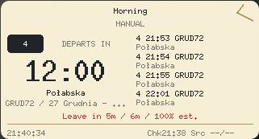
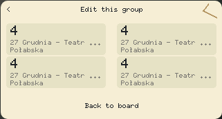
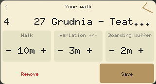

# Waveshare ESP32-C6-Touch-LCD-1.47

This target is the **touch** version with ESP32-C6FH8, 8 MB flash, JD9853 LCD
and AXS5106L touch controller. The non-touch ST7789 model has different wiring
and is not a compatible target. Choose the exact model above the installer demo.

The implementation follows Waveshare's [board documentation](https://docs.waveshare.com/ESP32-C6-Touch-LCD-1.47),
[schematic](https://files.waveshare.com/wiki/ESP32-C6-Touch-LCD-1.47/ESP32-C6-Touch-LCD-1.47-Schematic.pdf)
and [reference demo](https://files.waveshare.com/wiki/ESP32-C6-Touch-LCD-1.47/ESP32-C6-Touch-LCD-1.47-Demo.zip)
(`ESP-IDF/03_lvgl_example/components/esp_bsp`, `esp_lcd_jd9853` and
`esp_lcd_touch_axs5106`). No C/ESP-IDF runtime is linked into this Rust firmware.

| Signal | GPIO / configuration |
| --- | --- |
| LCD SCLK / MOSI | 1 / 2, SPI2 at 40 MHz |
| LCD CS / DC / RESET | 14 / 15 / 22 |
| Backlight | 23, hardware LEDC PWM at 20 kHz / 40% duty |
| Touch SDA / SCL | 18 / 19, I2C0 at 400 kHz |
| Touch RESET / INT | 20 / 21; polling, INT not used for deep sleep |
| Touch address | 0x63; register 0x01, separate write then 14-byte read |
| SD CS | 4, held high so the unused SD card cannot contend on SPI |
| USB D− / D+ | 12 / 13, reserved for USB Serial/JTAG |

Portrait LCD coordinates use visible controller columns 34–205 and rows 0–319,
RGB565 with RGB order and inversion enabled. Touch packets mirror X for this
orientation and reject off-panel coordinates. BOOT/strapping pins and USB pins
are not repurposed. Logs remain available through the installer's USB monitor.

The portrait renderer draws native text and controls into **172×16 tiles**,
borrowing **5,504 bytes** of the existing 8 KiB settings scratch. It needs no
framebuffer or additional heap. It shows a featured departure, direction,
platform, walking advice, three more departures, freshness and clock. Groups,
route/stop selection, walking editor and retry remain interactive. The browser
uses this same renderer and touch adapter in its existing fixed 4 MiB WASM
memory; it reuses the round preview's larger pixel buffer.

The CPU stays at 80 MHz and Wi-Fi shuts down between three-hour updates; NTP
runs before each connection's update. Cache restoration precedes Wi-Fi and
unchanged timetables are not rewritten. Default mode keeps the screen visible.
Optional Battery mode uses **screen standby** on this board: after 30 seconds,
the backlight turns off and a touch restores the screen without acting on that
first touch. The CPU continues Embassy idle sleep and touch polling. GPIO21 is
outside C6's RTC wake pins, so this target deliberately does not enter deep
sleep or claim the GUITION's touch-wake battery savings. Editors stay awake.

## Build and checks

The pinned firmware toolchain installs both RISC-V targets. Existing C3 commands
retain their default board. C6 commands require disabling the C3 default feature:

```sh
cd firmware
cargo clippy --locked --release --no-default-features --features firmware,board-waveshare-c6 --target riscv32imac-unknown-none-elf -- -D warnings
cargo test --locked --no-default-features --features board-waveshare-c6 --lib --test panel-c6 --test touch --target x86_64-unknown-linux-gnu
cd ..
sh tools/build-device-artifact.sh dist/firmware/devices/waveshare-c6 waveshare-c6
```

The builder emits C6 `latest.json`, chip-specific manifest, SHA-256, linked RAM
and stack audits. The image uses a C6 ROM-compatible DIO frequency header (0x0, generated with
`--flash-freq 40mhz`) and 8 MB flash geometry while retaining the shared
settings at 0x3f0000 and timetable cache at 0x300000. Remaining flash is reserved.
The linker caps HP RAM at 384 KiB and disables the secondary RAM section so the
whole linked allocation, including stack and retained state, stays below
400,000 bytes. The C3 300,000-byte minimum-reserve ratchet remains unchanged;
C6 has a separate 332,000-byte ratchet because its radio adds static IRAM/DRAM.
See [memory evidence](../PERFORMANCE.md#waveshare-c6-touch-target).

Host regressions check reference packet orientation/edges, all portrait screens
against tiled pixels, final-tile controller addresses, preview edits and model
persistence. CI builds and audits both hardware targets before publishing Pages.
These are compiler/host checks. Physical C6 display orientation, touch tracking,
USB recovery, radio/TLS heap high-water and power consumption still require a
board test; no physical-device validation is claimed.

## Landscape alternative

Select **Landscape** under Orientation in the installer after choosing the C6
Touch board. The page remembers this choice with your groups and Wi-Fi settings,
updates the real Rust/WASM preview, and downloads the matching firmware. Changing
orientation invalidates a prepared install; install again to change the device's
orientation. Portrait remains available, including existing saved browser drafts.

The native 320×172 layout places a large next departure beside four upcoming
services. Platform codes remain visible before shortened stop names. Cached
startup shows saved times and the saved date until NTP establishes the clock.
The groups and saved choices use four large cards in a 2×2 grid. Route and stop
lists show two larger-text choices per page, with swipe paging and separate
Previous/Next targets. Every choice remains reachable, and reopening a saved
stop goes to its actual page. The walking editor provides three large adjustment
areas and separated Save/Remove controls. Demo Apply/Reset actions remain visible
without opening the simulated hardware settings.







These are screenshots of the actual Rust/WASM renderer using sample departures,
not photographs of hardware. Desktop/mobile pointer tests exercise the same hit
regions as firmware, including the bottom-right choice, all walking fields,
list paging, cached startup, orientation persistence and switching back to portrait.
Physical display/touch alignment and comfort still require a board test.

Landscape follows the reference demo's 90° rotation: JD9853 MADCTL 0x60, column
range 0–319 and row offset 34. The touch adapter swaps the native AXS5106L axes.
It borrows 5,120 bytes for a 320×8 tile from the same settings scratch; the last
tile transfers only the remaining four rows. RAM/heap limits are unchanged.
No full framebuffer or second render buffer is added on the device; WASM also
reuses its existing pixel buffer within the same fixed 4 MiB memory.

```sh
cd firmware
cargo clippy --locked --release --no-default-features --features firmware,c6-landscape --target riscv32imac-unknown-none-elf -- -D warnings
cargo test --locked --no-default-features --features c6-landscape --lib --test panel-c6 --test touch --target x86_64-unknown-linux-gnu
cd ..
sh tools/build-device-artifact.sh dist/firmware/devices/waveshare-c6-landscape waveshare-c6-landscape
```

Landscape releases live at `devices/waveshare-c6-landscape/` and carry explicit
orientation metadata so a portrait image cannot be prepared for a selected
landscape layout. CI builds, checks and packages all three supported variants
before publishing Pages. Settings and timetable-cache formats are unchanged.
