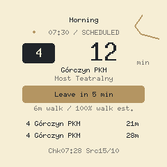

# Round timetable display

Rust firmware for **GUITION ESP32-2424S012-V1.0**, with an ESP32-C3, 4 MB flash,
240×240 round GC9A01 LCD and CST816 touch. It runs independently over 2.4 GHz
Wi-Fi, reading the official Poznań GTFS ZIP. No companion server is required.
The UI and installer use warm porcelain, dark ink, restrained kintsugi gold and
chilli red for the main action and departure urgency.



[Desktop installer preview](../docs/previews/installer-desktop.png) ·
[Mobile installer preview](../docs/previews/installer-mobile.png) ·
[Searchable stop picker](../docs/previews/installer-picker-mobile.png) ·
[Device editor](../docs/previews/device-walk.png) ·
[Offline board with retry](../docs/previews/device-offline.png) ·
[Check and source timestamps](../docs/previews/device-freshness.png).
These previews use illustrative departures; the device image comes from the
actual Rust renderer, not a photo of hardware.

## Install and use

The build workflow produces a `timetable-display` Actions artifact containing a
verified merged factory binary and the complete static USB installer. Main
builds deploy that installer through GitHub Pages. PRs build and test everything
without deploying. The published installer is at
<https://no-std-rs.github.io/timetable/>.

In the installer, name your groups, choose lines, directions and stops, and set
the walking time for each choice. Optionally schedule groups on selected days.
“Follow group schedules” enables automatic switching; turn it off to switch by
touch while retaining every saved time window. Imports expose that same mode
and offer Undo before further edits.
Then enter Wi-Fi settings and use desktop Chrome or Edge to install over USB.
Optional **Battery mode** sleeps after 30 seconds idle on the board. A tap wakes
saved departures without Wi-Fi; a timer refreshes every three hours (five-minute
retry after failure). Editors stay awake. See [battery mode](../docs/battery.md)
for retention, wake wiring and the remaining physical-board checks.
The website verifies SHA-256 before offering the binary. It sends settings as a
separate USB image, never to a server. The page remembers settings locally by
default; turn off Remember or use Forget on a shared computer. The firmware image itself contains no credentials. Installation replaces
the device's previous firmware and saved settings; device flash settings are
not encrypted.

If the screen stays black or the USB connection fails, hold **BOOT** while
reconnecting USB, release it, and select the new port in the installer. This
uses the ROM flasher without running the app; another firmware is unnecessary
as an intermediate step. See [boot failure and recovery](../docs/boot-recovery.md).

For Wi-Fi troubleshooting, open **Read device logs over USB** in the installer,
connect at 115200 baud and press RESET. Disconnect the monitor before flashing.
Startup logs distinguish radio initialization, station configuration,
association, DHCP/IPv4, NTP clock synchronization and timetable download.
Association failures include the driver reason and RSSI; DHCP and clock failures
have bounded retries. Diagnostics do not log SSID or passwords. A reported device successfully associated, acquired IPv4 and synchronized its
clock before exhausting the heap during RSA certificate verification. The radio
now uses a smaller buffer profile, while TLS retains its pinned root, hostname,
time and signature checks. A 24 KiB free-heap check rejects verification when
headroom is insufficient; the refresh retries rather than knowingly entering
the exhausted path. It is an admission check, not a reservation against radio
activity. The startup log and new TLS heap logs should be checked on hardware.
See [the offline reproduction and memory limits](../PERFORMANCE.md#tls-heap-exhaustion-correction).
The 64 KiB heap is unchanged. Two RX/TX queues and disabled aggregation trade
potential Wi-Fi throughput for certificate headroom; new hardware throughput
and combined peak RAM remain unmeasured.

On the display:

- **Swipe left/right:** change group, overriding automatic selection for two hours.
- **Tap the heading:** choose a group or return to the automatic schedule.
- **Hold the screen:** edit the current group. Tap a saved choice or “Add”.
- **Tap an offline/failed status above the departures:** retry while keeping cached times.
  Holding still opens the editor. A capacity error asks you to edit the selection.
- **Tap the footer:** see the last successful check and source file update times.
  `Chk14:32 Src15/10` keeps the board compact; older checks show their date.
  Details include year/time in Poznań and a retry action after a failed update.
  `Src` uses HTTP Last-Modified, falling back to the newest recognized GTFS
  table's UTC Info-ZIP timestamp after archive validation. ZTM's PHP endpoint
  currently needs this fallback. With multiple archives, the oldest source wins.
  If either metadata path is unavailable or invalid, the source is unknown.
  Service dates and response Date headers never substitute for source metadata.
- **Choose a line and stop:** swipe vertically or tap the bottom arrows for more.
  The stop page's bottom-centre control cycles either direction / 0 / 1.
- **Adjust your walk:** left/right decrements/increments walking time, its
  variation and the boarding buffer. Save commits; the top back control cancels.
  Tap the line badge to change the line, or the stop label to change the stop.
  The picker opens at the saved selection, highlights it and shows page counts.
  The bottom-centre stop control shows a destination and skips directions with
  no boarding stops. Back moves up one step; leaving the walk editor cancels its
  draft. Remove deletes a saved choice; Cancel discards a new unsaved one.

The next suitable scheduled departure is prominent; two later alternatives
remain visible. “Leave in” includes the walking time and boarding buffer. The
walking percentage uses your configured range and is explicitly an estimate,
not real-time vehicle reliability. `*` means conditional boarding.
Walking estimates of zero show “Not enough walk time” instead of “Leave now”.
Failed refreshes retain the last validated cache and show an offline indicator.
“NOT SAVED” means a settings write failed; retry Save before restarting.

The public image without a settings bank shows the USB setup screen and does
not start Wi-Fi. Group names and schedules can be configured in the installer;
line, stop, direction and walking settings can then be changed on the device.

## Data and memory

The bundled browse catalogue contains **212 routes, 3,232 boarding stops and 10,614
route/stop links**, generated from the official 2026-10-15 feed. It occupies
461,316 flash bytes and is read directly from flash. It contains no departures.
See [catalogue provenance](../catalog/README.md). Route short names and physical
stop codes are resolved against each new feed, so saved numeric GTFS IDs may
change without selecting a different line or platform. Ambiguous or missing
identities fail explicitly. Refresh the catalogue when lines/stops change.

After DHCP, SNTP supplies UTC before TLS certificate validity is checked. The
pure Rust `embedded-tls` transport verifies ZTM's hostname and pinned Certum
root; `reqwless` parses streaming HTTP responses. Compressed HTTP representations
and redirects are rejected. The official listing selects a dated immutable ZIP
for each required service day: yesterday, today, and tomorrow when its GTFS
service epoch enters the horizon. At the spring clock change this can happen
before civil midnight. Dates sharing the same latest archive reuse one set of three
passes for calendars, selected trips and departures. Each distinct archive
gets its own three-pass validation. This reduces retained metadata versus
indexing inactive services. The generic `gtfs` crate's existing two-pass and
mirror-assisted APIs remain available.

A first refresh downloads several ZIP streams and may take minutes on a slow
network. Touch and drawing run separately. A successful refresh caches six hours
of departures and refreshes after three hours; failures retry after a minute.
Wi-Fi reassociation wakes the update task instead of waiting for that timer.
Config changes cancel an obsolete in-flight query. Network or validation
failure never publishes provisional results. The previous/current/next
service-day window covers Poznań's normal after-midnight trips; feeds with service times
extending past two civil days need a wider application policy.

The footer marks connection, clock synchronization and timetable updates even
while a cached board stays visible. Downloads yield to other ready executor
tasks after each 2 KiB of HTTP stream reads. This is a scheduling point rather
than a measured physical touch-latency bound; TLS handshakes and decompression
also contribute work. A manual retry interrupts the failed clock-sync wait too.

Both application crates are `no_std` and use no allocator. Radio and RSA TLS use
a fixed **64 KiB heap**. The panel's **7.5 KiB tile** borrows the idle 8 KiB
settings scratch buffer, with no framebuffer or pixel conversion buffer.
The tile reports its actual drawing bounds, so off-tile text and primitives are
skipped before rasterization. Full-frame and tiled rendering are pixel-equivalent.
Each 512-entry departure cache stores four-byte entries with one shared UTC
epoch; access reconstructs full `i64` timestamps, including after 2038.
TLS borrows its verifier and connection instead of moving large async state.
`tools/check-device-ram.py` counts actual linked IRAM/DRAM sections, including
radio, heap, all async tasks and application state; alias dummy sections are
excluded. The static-plus-minimum-stack regression account is **297,892 B**,
including the unchanged 64 KiB heap and 24 KiB minimum reserve, below the unchanged
**300,000-byte ceiling**. This account is not the runtime peak: TLS needs more
stack. Static RAM plus all 51,288 linker-available stack bytes is **324,604 B**,
below 400,000 B. `RAM.json` labels both quantities explicitly.
`tools/check-device-stack.py` reads linked DWARF frames with GNU `readelf`,
checks audited boot paths against 24 KiB and runtime paths against the actual
available stack, with 4 KiB headroom. The original binary fails this check.
`STACK.json` records the scoped audit; it is not a complete call-graph proof or
physical high-water measurement. See [boot-stack details](../docs/boot-recovery.md).
Physical screen/radio/touch behaviour still requires the board. No hardware test has been
performed as part of this implementation. Serial logs report allocator current,
peak-since-boot and total bytes after startup and refresh attempts, including
allocations already freed by the TLS handshake. Keep the full heap allowance
until these logs and physical stack measurements justify reducing it.

The fixed app limits are four groups, four choices each, 1,024 active trips in a
16 KiB exact ID pool, 64 distinct service IDs across the date window (including
removals), 32 headsigns in a 1 KiB pool and 512 future events. Large selections
fail visibly rather than dropping departures.

## Build and inspect

From the repository root, with `espflash 4.4.0` installed:

```sh
sh tools/build-device-artifact.sh
npm --prefix web ci
npm --prefix web run build
npm --prefix web test
python3 tools/assemble-installer.py dist/firmware dist/installer
node web/tests/server.mjs
```

Open <http://127.0.0.1:4197/>. The server serves the built binary with the source
installer; `dist/installer/` is the self-contained deployable site.

From `firmware/`:

```sh
cargo fmt --all --check
cargo test --lib --tests --locked --target x86_64-unknown-linux-gnu
cargo clippy --locked --release --features firmware -- -D warnings
cargo build --locked --release --features firmware
# Host CPU benchmark of the actual tile renderer, excluding SPI:
cargo run --locked --release --example bench_render --target x86_64-unknown-linux-gnu -- 512
# Only with a connected matching board and intentional replacement:
cargo run --locked --release --features firmware
```

The pinned Rust 1.95.0 toolchain builds the stable `riscv32imc-unknown-none-elf`
target; no ESP-IDF application or C application code is used. Espressif's radio
firmware and ROM routines are required by `esp-radio`, as in the source demo.
The bootloader/image format is compatible with ESP Web Tools.

Board wiring and panel setup come from the neighbouring router demo; see
[NOTICE](NOTICE). LCD SCK/MOSI/DC/CS/backlight are GPIO6/7/2/10/3; touch
SDA/SCL/reset/interrupt are GPIO4/5/1/0. Touch is polled while awake; GPIO0 wakes
deep sleep. GPIO10 is LCD CS. The [manufacturer schematic](../docs/battery.md)
corrects the inherited demo's interrupt-pin note. SPI is 40 MHz.
The factory partition ends at `0x3f0000`; the 64 KiB
`timetable` partition contains independent settings banks at `0x3f0000` and
`0x3f8000`. DIO/80 MHz matches this board.
